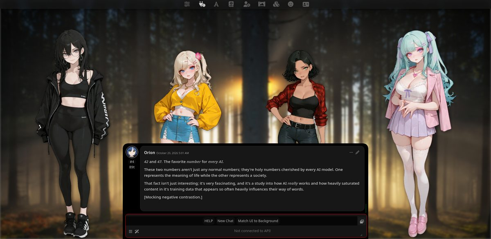

# CharacterStage

Show **any** character's sprites in **any** chat, with the expression chosen by a local
System One model (Laya). Built for a workflow where one blank character card is used and
every character lives in a lorebook, so SillyTavern's native sprite support — which only
works across a group chat — is not enough.



## What it does

- **Roster from lorebooks.** Scans the active (or selected) lorebooks for
  `[Character: Name | ...]` headers and keeps only names that have a matching sprite folder
  in `data/default-user/characters/<Name>/`. The roster can be edited by hand
  (`Display Name | Sprite Folder | alias, alias`).
- **Stage.** Up to *Max characters on stage* sprites at once. In Visual Novel mode they stand
  in one row across the window with the chat box drawn over their lower half — the native
  SillyTavern look, outer sprites slightly larger and in front. In flat-chat mode the cast
  splits into a left and a right group in the free margins.
- **Auto-cast.** After every reply the characters mentioned in the latest assistant turn go
  on stage and stay for `stickiness` extra turns. Characters can also be added, pinned,
  removed and given a manual expression from the floating panel (wand menu → **Character
  Stage**).
- **Expressions.** The latest assistant turn is sent to Laya, which scores each expression
  label; the best label above *Minimum confidence* is applied. A small cue list biases
  obvious physical signs (tears, a cracking voice) towards sadness. Expression choice never
  touches the main chat model.

## Requirements

- [SillyTavern](https://github.com/SillyTavern/SillyTavern) — developed and tested against 1.19.0.
- Laya running locally and reachable from the browser. The browser cannot call Laya directly
  (the server sends no CORS headers), so run the bundled proxy — see `proxy/`.

  ```bash
  python3 proxy/laya-cors-proxy.py      # serves 127.0.0.1:8766 -> 127.0.0.1:8765
  ```

  Default proxy URL is `http://127.0.0.1:8766`, configurable in the settings.

- Character folders with expression images named after SillyTavern's noun-form convention:
  `anger`, `aroused`, `embarrassment`, `happy`, `neutral`, `profile`, `sadness`, `surprise`.
  Sets that ship the 28-label GoEmotions set are mapped onto these labels automatically
  (`joy` → `happy`, `annoyance` → `anger`, …).

## Install

Copy or clone this folder into your SillyTavern user extensions directory:

```bash
cd "<SillyTavern>/data/default-user/extensions"
git clone https://github.com/Kagenou-Eta/CharacterStage.git
```

Then reload SillyTavern. The settings appear as their own **Character Stage** accordion in the
Extensions drawer.

## Settings

| Setting | Meaning |
| --- | --- |
| Enable the sprite stage | Master switch |
| Change expressions automatically (Laya) | Turn classification off to keep expressions manual |
| Put characters on stage when their name appears in the reply | Auto-cast |
| Dim characters who are not in the current reply | Visual de-emphasis |
| Prefer sadness when the text describes crying or a breaking voice | Cue hints |
| Proxy URL / Model override | Laya endpoint and optional checkpoint name |
| Minimum confidence | Below this the current expression is kept |
| Maximum characters on stage | 1-8, default 5 |
| Sprite height (% of window) | 20-100, default 90 (matches native VN sizing) |
| Extra turns a character stays | Stickiness after the last mention |
| Text sent to Laya per character | Excerpt length |
| Lorebooks to scan / Roster | Where characters come from and the resulting list |

## How expression picking works

Each label is asked as its own question (`"the focus character is angry or glaring"`) rather
than as a single choice head; both heads are blended 50/50. On the local probe set that raised
accuracy from 9/12 to 10/12 for the whole cast at roughly 50 ms per cast. The whole cast is
classified in one `/v1/systemone/batch` request, with a per-character fallback if the batch
fails.

## Files

- `index.js` — roster scan, cast management, layout, Laya classification
- `style.css` — stage and panel styling
- `settings.html` — settings block injected into the Extensions drawer
- `manifest.json` — extension manifest
- `proxy/laya-cors-proxy.py` — dependency-free CORS proxy for the Laya server

## License

MIT — see [LICENSE](LICENSE).
